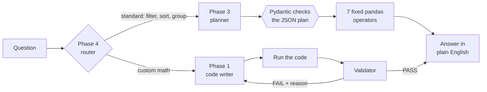

# csv-data-agent

[](https://github.com/amriikk/csv-data-agent/actions/workflows/tests.yml)

Ask questions about a CSV in plain English and get answers computed from the data.

The project is built as four LangGraph agents, one per phase, to explore a real trade-off in AI data tools: **letting the model write code** is flexible but risky, while **making the model fill in a checked plan** is safe but limited. Phase 4 routes each question to the right one.

It runs on a dataset of 4,600 of the most-streamed songs of 2024 (Spotify, YouTube and TikTok numbers), using Claude Haiku 5.5.

## Example run

Real output from `python -m apps.phase_4_orchestrator.agent` (lightly trimmed):

```text
================== TEST 1 ==================
[Orchestrator] Analyzing query for optimal routing...
  -> Decision: DETERMINISTIC (Selecting the top 5 tracks sorted by YouTube views is a standard
     sort and limit operation that pre-defined JSON operators can handle.)
[Node: execute_plan] Executing plan against shared operators...
  -> Step 1: Running sort_rows...
  -> Step 2: Running limit_rows...
  -> Step 3: Running select_columns...

FINAL ANSWER:
The top 5 tracks by YouTube views are:
1. Baby Shark by Pinkfong: about 16.32 billion views
2. Despacito by Luis Fonsi: about 9.54 billion views
3. Shape of You by Ed Sheeran: about 8.01 billion views
4. bathroom floor by Kids With Buns: about 6.74 billion views
5. Perfect by Ed Sheeran: about 6.47 billion views

================== TEST 2 ==================
[Orchestrator] Analyzing query for optimal routing...
  -> Decision: EXPERIMENTAL (Computing a custom correlation matrix and summarizing the trend
     requires custom statistical math that standard filter/sort/aggregate operators cannot handle.)
[Node: generate_code] Synthesizing pandas pipeline...
[Node: execute_code] Executing generated pipeline...
[Node: evaluate_result] Validating output...
  -> Validation status: PASS

FINAL ANSWER:
Across 3,309 tracks, Spotify Popularity and TikTok Likes have a weak relationship. The Spearman
rank correlation is 0.162 [...] The Pearson correlation is -0.047, slightly negative, so the
linear relationship is essentially nonexistent [...]
```

I checked these numbers directly with pandas: the top 5, the 3,309 tracks with both values, and both correlations match.

## How it works



| Phase | Folder | What it does |
|---|---|---|
| 1. Code writer | `apps/phase_1_codegen` | Claude writes pandas code, it runs, and a second Claude call checks the result. If the code crashes or the check fails, the retry shows Claude its last code and the reason. |
| 2. API with memory | `apps/phase_2_stateful` | Serves Phase 1 through FastAPI. Each `session_id` keeps its own question-and-answer history (LangGraph checkpointer), so follow-ups like "what about their YouTube views?" work. |
| 3. Planner | `apps/phase_3_guardrails` | Claude doesn't write code. It returns a JSON plan built from 7 operators (`filter_rows`, `group_and_aggregate`, `sort_rows`…). Pydantic rejects any plan that uses an unknown operator, and the plan runs on fixed, tested pandas functions. |
| 4. Router | `apps/phase_4_orchestrator` | Sends standard questions to the planner and custom math to the code writer. The route is one of two allowed values, enforced by Pydantic. |

Shared code lives in `libs/`: the data cleaner, the 7 operators, and `llm.py`, the one place the model is set.

### Why Phase 3 exists

Phase 1 runs model-written code with Python's `exec()`. That is **not a sandbox**: the code has full access to the machine it runs on. It's fine for a local experiment, and it's the reason Phase 3 replaces free-form code with a short list of operators. The router keeps the flexible path for questions the operators can't answer.

## Engineering notes

Problems I found and fixed while turning this into a portfolio piece:

- **A library upgrade blanked the data.** The cleaner looked for pandas' old text type (`object`); pandas 3 uses `str`. The comma-stripping never ran, so *Spotify Streams* was empty in 4,600 of 4,600 rows while the agents still answered confidently. The cleaner now checks every column and only converts a column when every value is a number. A test confirms no column loses a value.
- **The retry never retried.** The failure counter reached the limit before the check ran. It now retries once and passes the error or the validator's reason back to the model.
- **Legacy model.** Moved from Claude Haiku 4.5 to Haiku 5.5, which no longer accepts `temperature` and can start a reply with a thinking block, so replies are read with `.text` and `max_tokens` is set explicitly.

## Run it

You need Python 3.13+, [Poetry](https://python-poetry.org/) 2, and an [Anthropic API key](https://console.anthropic.com/).

```bash
git clone https://github.com/amriikk/csv-data-agent.git
cd csv-data-agent
poetry install
export ANTHROPIC_API_KEY="your-key"
```

**The router (Phases 3 + 4):**

```bash
poetry run python -m apps.phase_4_orchestrator.agent
```

**The API with follow-up memory (Phases 1 + 2):**

```bash
poetry run python -m apps.phase_2_stateful.server
```

Then, in a second terminal, ask a question and a follow-up in the same session:

```bash
curl -X POST http://localhost:8000/api/v1/analyze \
  -H "Content-Type: application/json" \
  -d '{"question": "Which 3 artists have the most total Spotify Streams?", "session_id": "demo"}'

curl -X POST http://localhost:8000/api/v1/analyze \
  -H "Content-Type: application/json" \
  -d '{"question": "What about their total YouTube views?", "session_id": "demo"}'
```

To try another model: `export ANTHROPIC_MODEL="claude-sonnet-5-5"`.

## Tests

```bash
poetry run pytest
```

24 tests cover the cleaner, all 7 operators, the retry and memory logic, the API endpoint, and the Pydantic checks. They replace Claude with scripted replies, so they run offline with no API key. GitHub Actions runs them on every push.

## Limitations

- Phase 1's `exec()` isn't sandboxed (see above). Run it locally only.
- Session memory lives in the server's memory and resets when it restarts.
- The data path and some prompts are specific to the Spotify CSV.
- Some non-Latin song titles are unreadable in the source file itself.

## Data

[Most Streamed Spotify Songs 2024](DATASET_LINK), from Kaggle. DATASET_LICENSE

## Author

**Jhon Trujillo** · [jotrio.com](https://jotrio.com) · [github.com/amriikk](https://github.com/amriikk)